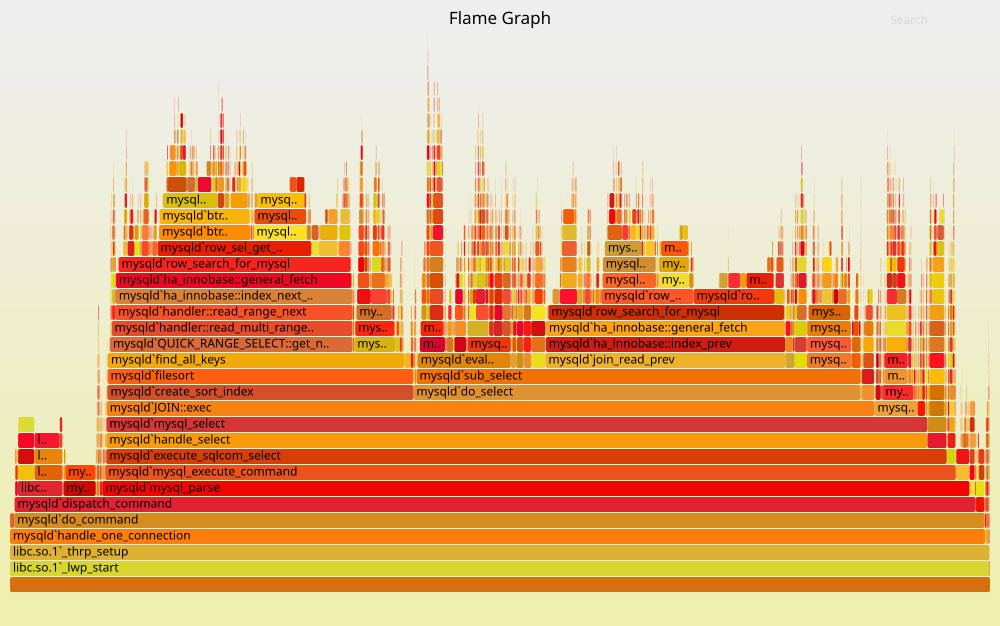
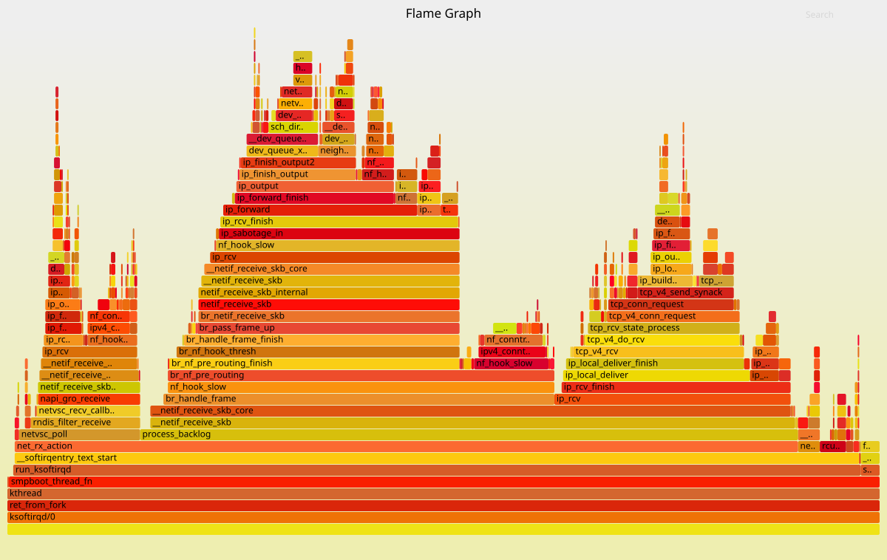
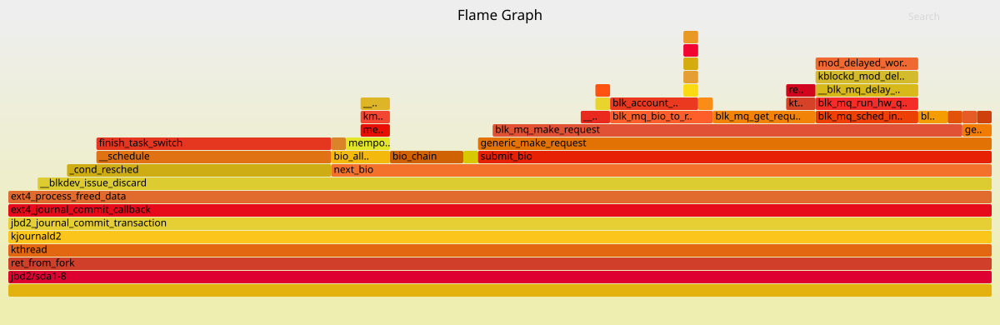

# 火焰图

火焰图可以以矢量图的方式动态展示通过 perf、systemtap、bpftrace 等各种工具获取的性能剖析数据。

## 使用方法

```sh
# 下载开源火焰图工具集
$ git clone https://github.com/FlameGraph/FlameGraph
$ cd FlameGraph

# 使用perf记录性能数据
$ perf record -a -g -- sleep 30

# 生成火焰图
$ perf script -i perf.data | ./stackcollapse-perf.pl --all |  ./flamegraph.pl > ksoftirqd.svg
```

## 示例火焰图

**数据库火焰图**



**ksoftirqd 火焰图**



**jbd2 火焰图**


